<div align="center">

# SmartFit Clinic — BLE Vitals + AI Triage for Small Clinics

**An offline-first Android app that captures patient vitals wirelessly from a custom ESP32 sensor over Bluetooth Low Energy, stores them locally with cloud backup, and runs AI-powered clinical triage using Llama 3.3 70B via Groq.**


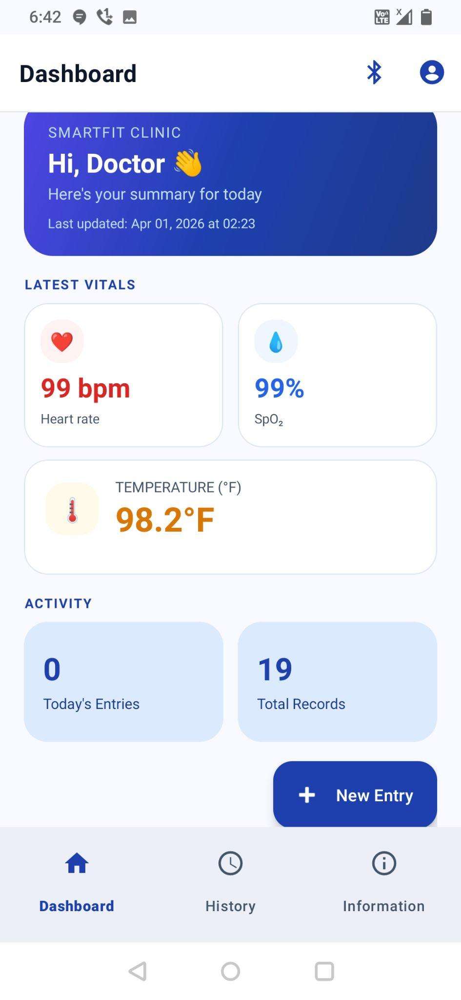&nbsp;&nbsp;
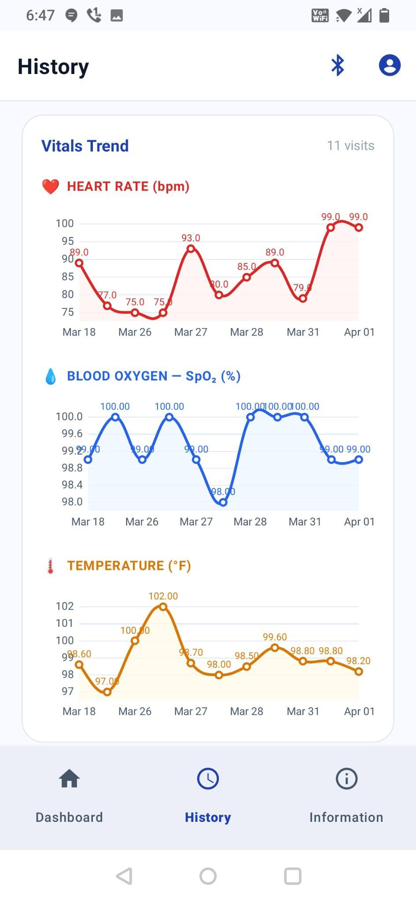&nbsp;&nbsp;
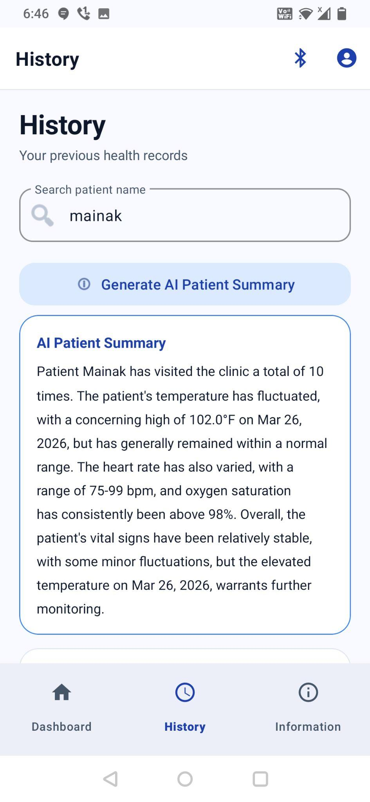

</div>

---

## Table of Contents

- [Overview](#overview)
- [The Problem](#the-problem)
- [Key Features](#key-features)
- [Screenshots](#screenshots)
- [System Architecture](#system-architecture)
- [SmartFit Sensor Module (Hardware)](#smartfit-sensor-module-hardware)
- [BLE Protocol](#ble-protocol)
- [AI Integration — Groq Llama 3.3 70B](#ai-integration--groq-llama-33-70b)
- [Tech Stack](#tech-stack)
- [Project Structure](#project-structure)
- [Getting Started](#getting-started)
- [Permissions Model](#permissions-model)
- [Database Schema](#database-schema)
- [Testing](#testing)
- [Design Diagrams](#design-diagrams)
- [Known Limitations](#known-limitations)
- [Future Enhancements](#future-enhancements)
- [References](#references)
- [License](#license)

---

## Overview

Clinic management in small outpatient settings still relies on paper-based vitals recording: doctors read values off a pulse-oximeter or thermometer, transcribe them by hand, and interpret raw numbers with no automated guidance. This creates both **transcription errors** (documented in 12–18 % of readings in busy clinics) and **missed risk signals**.

**SmartFit Clinic** replaces that workflow with a native Android application plus a custom-built hardware sensor:

| Layer | What it does |
|---|---|
| **SmartFit Sensor Module** | ESP32 + MAX30102 pulse-oximeter + MLX90614 IR thermometer + SSD1306 OLED. Runs a 20-second averaging cycle and pushes `HR`, `SpO₂` and `Temp` in a single BLE notification. |
| **Android app** | MVVM, Kotlin Coroutines, StateFlow. Room (SQLite) is the single source of truth; Firebase Firestore provides best-effort cloud backup. |
| **AI layer** | Groq API running `llama-3.3-70b-versatile` for real-time triage (Normal / Caution / Urgent), patient-history summaries and an interactive medical chat assistant. |

The app also ships with dark mode, full Hindi localisation, MPAndroidChart trend graphs, and a Kotlin Multiplatform `:shared` module as the foundation for a future iOS build.

> Both the Android application and the ESP32 sensor firmware are custom-built for this project.

---

## The Problem

| Pain point in small clinics | How SmartFit addresses it |
|---|---|
| Paper vitals recording is slow and error-prone | Structured digital entry form with validation |
| Finding a returning patient's history means flipping through files | Instant name-based search across all visit records |
| Reading a device and typing the numbers introduces errors | ESP32 sensor captures HR, SpO₂ and temperature wirelessly — zero transcription |
| No structured way to spot dangerous vitals patterns | AI risk triage after every entry, with explanation and next steps |
| Data lost if the phone is lost or damaged | Firestore cloud backup with restore-on-login |
| Unreliable internet in Tier-2/3 clinics | Offline-first: every record operation works entirely on-device |

---

## Key Features

### 🩺 Patient Record Management
- Structured `HealthRecord` per visit: patient name, age, heart rate, SpO₂, temperature, timestamp.
- Records grouped by date on the **History** screen, with real-time, debounced, case-insensitive name search.
- Swipe-to-delete with confirmation dialog.
- Dashboard shows the latest vitals cards, today's entry count and total records.

### 📡 BLE Device Integration
- Scans for the SmartFit sensor using a **service-UUID filter** so unrelated BLE devices never appear.
- Connects over GATT, **negotiates MTU 512** so the ~24-byte vitals string is never silently truncated at the default 20-byte payload.
- Subscribes to characteristic notifications and **filters zero-value mid-measurement packets** at both the `BleRepository` and ViewModel layers.
- `suppressAutoSave` flag lets the Add Entry dialog attach a patient name and age before a BLE reading is persisted.
- Foreground `HealthService` keeps the GATT connection alive while a device is connected.

### 🤖 AI-Powered Clinical Intelligence (Groq · Llama 3.3 70B)
1. **Vitals triage** — after every save, a bottom sheet shows a colour-coded risk chip (🟢 Normal / 🟠 Caution / 🔴 Urgent), a clinical explanation and suggested next steps.
2. **Patient history summary** — the patient's last 10–20 records are serialised into a prompt and the model returns a concise "progress note" (e.g. *"Recurring febrile episodes observed"*).
3. **AI Health Assistant** — full multi-turn chat with message history, quick-reference card of normal vitals ranges, and a system prompt that enforces a *recommendation-not-diagnosis* persona with a human-in-the-loop disclaimer.

### ☁️ Offline-First with Cloud Backup
- Room is written **synchronously first**; Firestore upload is a fire-and-forget coroutine with a 4-second timeout — a failed upload never rolls back the local record.
- On login, missing records are restored from `users/{uid}/health_records`.
- Firestore security rules enforce per-user isolation (`request.auth.uid == userId`).

### 🎨 UX
- Material Design 3 with a deep-indigo theme and a dedicated triage colour system.
- Dark mode and English ⇄ Hindi toggles persisted via Jetpack DataStore, applied instantly without restart.
- Interactive MPAndroidChart line charts (pinch-to-zoom) for HR, SpO₂ and temperature, shown whenever a patient search yields ≥ 2 records.

---

## Screenshots

All screenshots below are taken from the project report.

### Onboarding & Dashboard

| Splash | Dashboard | Add Entry (Manual) |
|:---:|:---:|:---:|
| 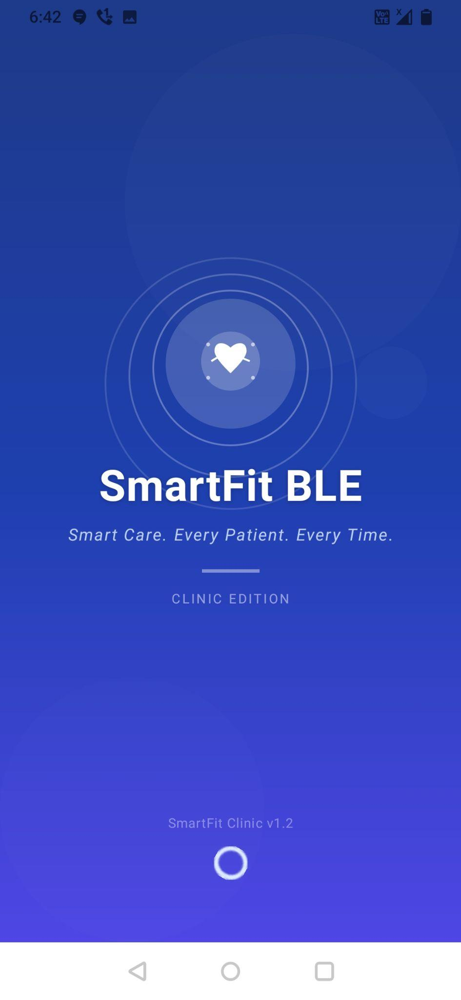 |  | 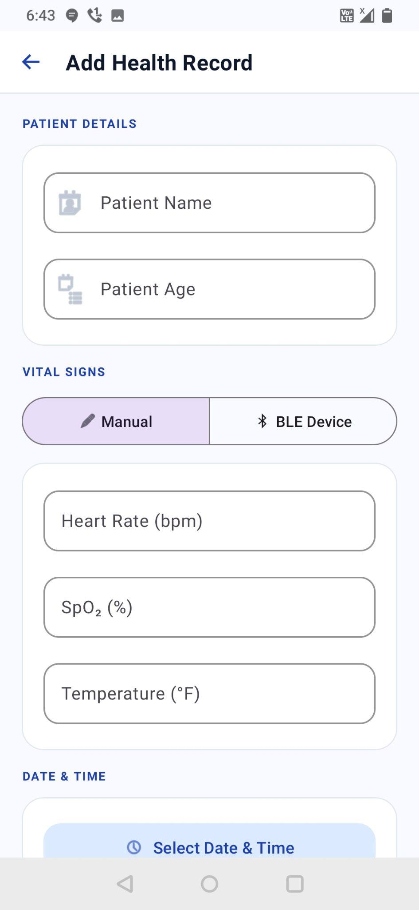 |
| Branded launch with pulse-ring animation; checks Firebase session and routes to Dashboard or Login. | Personalised greeting, latest HR / SpO₂ / Temp cards, activity counters and the **New Entry** FAB. | Full-screen `DialogFragment` with a **Manual / BLE Device** segmented toggle. |

### History & Trends

| Patient Search | Vitals Trend Charts | AI Patient Summary |
|:---:|:---:|:---:|
| 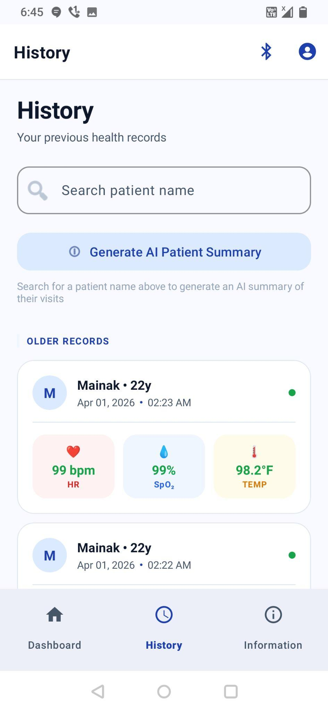 |  |  |
| Date-grouped records with real-time name search; each card shows HR, SpO₂ and Temp. | MPAndroidChart line charts for heart rate, SpO₂ and temperature across visits. | Groq-generated progress note summarising the patient's visit history. |

### AI Assistant & Profile

| AI Health Assistant | Profile (Dark) | Profile (Light) |
|:---:|:---:|:---:|
| 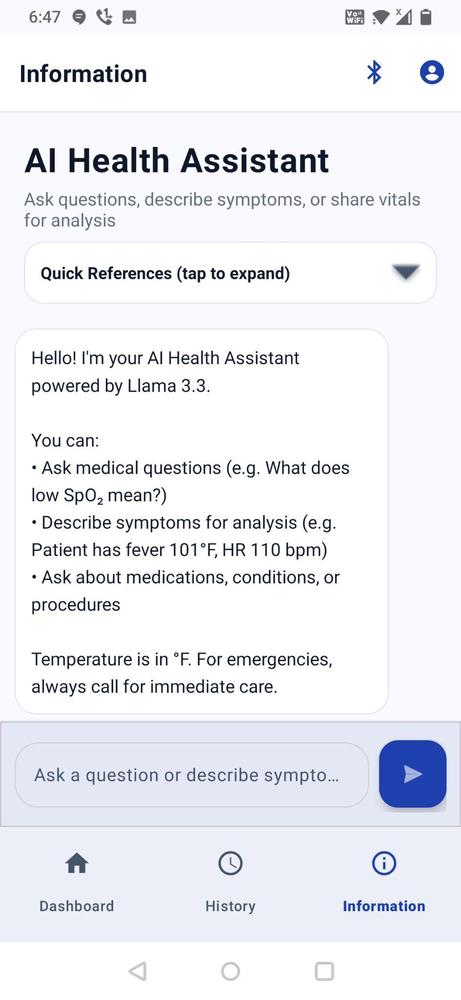 | 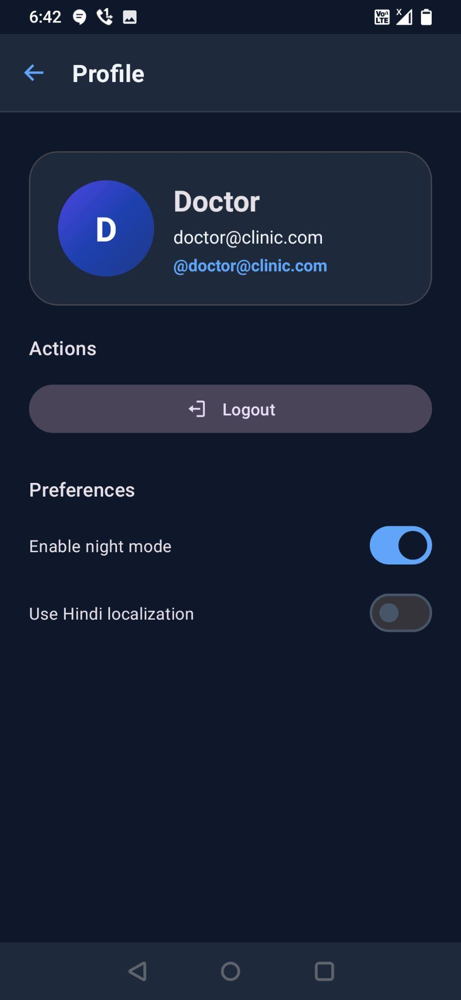 | 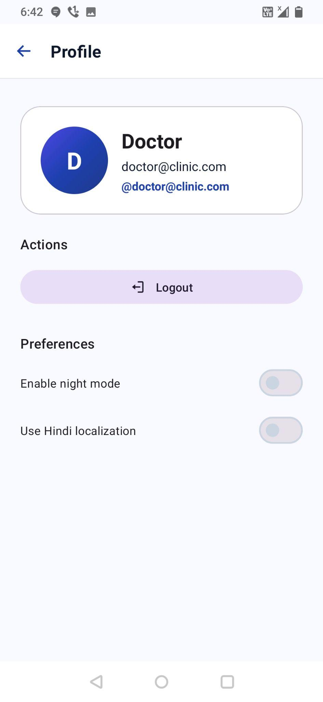 |
| Conversational chat with the clinical assistant, quick-reference card and typing indicator. | Doctor avatar, logout, and toggles for night mode and Hindi localisation. | Same screen in light theme. |

---

## System Architecture

The app follows **MVVM** with a repository layer as the single source of truth. All UI state is exposed as `StateFlow`; ViewModels survive configuration changes so screen rotation never re-fetches data.

```
┌──────────────────────────────────────────────────────────────────┐
│  View  (Activities / Fragments, View Binding, Navigation)         │
│  Splash · Login · Dashboard · AddEntry · History · Graphs ·       │
│  Devices · Information (AI chat) · Profile                        │
└───────────────▲──────────────────────────────────────────────────┘
                │ observes StateFlow / SharedFlow
┌───────────────┴──────────────────────────────────────────────────┐
│  ViewModel  (UI state + business logic, viewModelScope)           │
└───────────────▲──────────────────────────────────────────────────┘
                │
┌───────────────┴──────────────────────────────────────────────────┐
│  Repository layer                                                 │
│   HealthRepository ─► Room (sync) ─► Firestore (async, 4 s cap)   │
│   BleRepository    ─► BluetoothLeScanner / BluetoothGatt          │
│   GroqAiService    ─► https://api.groq.com  (OkHttp)              │
│   SessionManager / UserPreferences ─► DataStore                   │
└──────────────────────────────────────────────────────────────────┘
```

Dependencies are wired manually through a lazy-singleton `AppContainer` (no DI framework). `HealthDatabase` and `BleRepository` are singletons — opening multiple SQLite connections or binding the Bluetooth adapter twice would crash the process.

### Data flow for one patient encounter

<p align="center">
  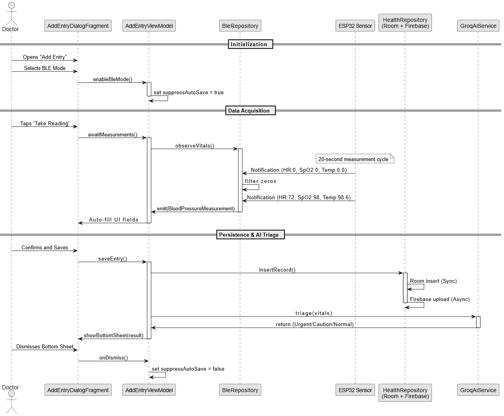
</p>

1. Doctor opens **Add Entry** and selects **BLE Device** mode → `AddEntryViewModel.enableBleMode()` sets `suppressAutoSave = true`.
2. Doctor taps **Take Reading** → `BleRepository.observeVitals()` subscribes to the sensor characteristic.
3. During the 20-second cycle the ESP32 sends `HR:0,SpO2:0,Temp:0.0` status packets — these are filtered out.
4. The final notification (`HR:72,SpO2:98,Temp:98.6`) is parsed and auto-fills the UI fields.
5. Doctor confirms name/age and saves → `HealthRepository.insertRecord()` writes Room synchronously, then uploads to Firestore asynchronously.
6. `GroqAiService.triage(vitals)` runs in parallel; the result is shown in a bottom sheet.
7. Dismissing the sheet resets `suppressAutoSave = false`.

### Module structure

| Module | Purpose |
|---|---|
| `:app` | Android application — Activities, Fragments, ViewModels, Room, Firebase, BLE, Groq. |
| `:shared` | Kotlin Multiplatform module. `commonMain` holds `BleManager` (`expect`), `AuthClient` (Ktor) and shared models; `androidMain` / `iosMain` hold `actual` implementations (currently stubs). |
| `firmware/` | Arduino sketch for the ESP32 SmartFit Sensor Module. |

---

## SmartFit Sensor Module (Hardware)

A standalone IoT sensing unit for non-invasive vitals acquisition.

| Component | Role | Interface |
|---|---|---|
| **ESP32 DevKitC** | Dual-core 240 MHz MCU. Hosts the BLE GATT server and drives the I²C bus. | — |
| **MAX30102** | Pulse-oximeter & heart-rate sensor. Red (660 nm) + IR (880 nm) LEDs with photodetector for PPG; 100 Hz sampling. Uses Maxim's open-source SpO₂/HR algorithm on 100-sample batches. | I²C `0x57` |
| **MLX90614** | Non-contact infrared thermometer. 17-bit ADC, 0.02 °C resolution. 5-sample moving-average filter plus an empirical **+7.5 °C body offset** to map skin-surface to core temperature. | I²C `0x5A` |
| **SSD1306 128×64 OLED** | Shows *"Processing…"* progress during the measurement cycle and the final vitals afterwards. | I²C `0x3C` |

**Wiring:** shared I²C bus on **GPIO 21 (SDA)** / **GPIO 22 (SCL)** with 4.7 kΩ pull-ups. Powered from 5 V USB, regulated to 3.3 V by the ESP32's on-board LDO. Production enclosure design uses a 3.7 V LiPo with a TP4056 charger in a 3D-printed case.

### Firmware state machine

```
IDLE ──(finger detected: IR > threshold)──► PROCESSING ──(20 s elapsed)──► FINALIZE ──► DISPLAY
  ▲                                            │                              │
  │                                            │ every tick: notify            │ notify once:
  │                                            │ "HR:0,SpO2:0,Temp:0.0"        │ "HR:72,SpO2:98,Temp:98.6"
  └────────────────(finger removed / re-placed)─┴──────────────────────────────┘
```

- **Idle:** polls the MAX30102 IR channel; a finger-detect threshold starts the cycle.
- **Processing (20 s):** collects 100 samples/s, runs the Maxim HR/SpO₂ algorithm, samples the MLX90614, and sends zero-value *status packets* so the app can show progress and the link stays alive.
- **Finalize:** averages the accumulated readings, clamps to physiological ranges, applies the temperature offset, and sends **one** UTF-8 notification with the final values.
- The OLED refresh is timed so it never interrupts the MAX30102's time-sensitive I²C reads.

Firmware lives in [`firmware/sketch_apr30a_latest/`](firmware/sketch_apr30a_latest) and depends on the SparkFun **MAX3010x** library (`MAX30105.h` + `spo2_algorithm.h`), **Adafruit SSD1306 / GFX**, **Adafruit MLX90614**, and the **ESP32 BLE Arduino** stack.

---

## BLE Protocol

| Item | Value |
|---|---|
| Role | ESP32 = GATT **peripheral/server**; Android = **central/client** |
| Service UUID | `12345678-1234-1234-1234-1234567890ab` |
| Vitals characteristic UUID | `abcd1234-5678-1234-5678-1234567890ab` (properties: `READ`, `NOTIFY`; CCCD `0x2902`) |
| Payload | UTF-8 string, comma-separated: `HR:<bpm>,SpO2:<%>,Temp:<°F>` |
| Mid-measurement packet | `HR:0,SpO2:0,Temp:0.0` — discarded by the app |
| MTU | App requests **512** on connect (default 23 → 20-byte payload would truncate the string) |
| Android scan filter | `ScanFilter.setServiceUuid(SERVICE_UUID)` — only SmartFit devices are listed |

---

## AI Integration — Groq Llama 3.3 70B

All inference is cloud-based via the Groq OpenAI-compatible endpoint (`/openai/v1/chat/completions`, model `llama-3.3-70b-versatile`). Groq's LPU engine gives sub-second first-token latency, so triage appears almost immediately after a record is saved.

| Capability | Trigger | Prompting strategy |
|---|---|---|
| **Vitals triage** | After every record save | System prompt enforces a structured response (`RISK:` / `EXPLANATION:` / `NEXT_STEPS:`) that is parsed deterministically into a `RiskLevel` (NORMAL / CAUTION / URGENT), summary and recommendation. |
| **Patient history summary** | "Generate AI Patient Summary" on the History screen | The patient's recent records are serialised into the prompt; the model acts as a medical scribe and returns a progress note. |
| **AI Health Assistant** | Information tab | Multi-turn chat. `InformationViewModel` keeps the full `List<ChatMessage>` and sends it with every request so follow-up questions retain context. |

**Safety design:** the assistant is instructed to give *clinical suggestions*, not diagnoses; every output is intended to be vetted by the presiding doctor, and the UI carries a disclaimer to that effect.

---

## Tech Stack

| Layer | Technology |
|---|---|
| Language | Kotlin 1.9 (KSP for Room codegen), JVM target 17 |
| Architecture | MVVM · Jetpack ViewModel · StateFlow / SharedFlow · Navigation Component · View Binding |
| Async | Kotlin Coroutines 1.8 |
| Local storage | Room 2.6.1 (reactive `Flow` queries) · DataStore Preferences 1.1.1 |
| Cloud | Firebase BOM 32.7.3 — Authentication, Firestore, Analytics |
| BLE | Android `BluetoothLeScanner` / `BluetoothGatt` + foreground `HealthService` |
| AI | Groq API via OkHttp 4.12 |
| Charts | MPAndroidChart v3.1.0 |
| UI | Material Components 1.12 (Material 3), Core SplashScreen 1.0.1, Coil 2.4.0 |
| Multiplatform | Kotlin Multiplatform `:shared` module with Ktor 2.3.8 + kotlinx.serialization |
| Firmware | Arduino framework on ESP32 · SparkFun MAX3010x · Adafruit SSD1306 / GFX / MLX90614 · ESP32 BLE |
| Build | Gradle Kotlin DSL · AGP 8.2.2 · `minSdk 23` · `targetSdk / compileSdk 34` |

---

## Project Structure

```
SmartFitBLE/
├── app/src/main/java/com/smartfit/ble/
│   ├── SmartFitApp.kt                 # Application class, initialises AppContainer
│   ├── di/AppContainer.kt             # manual DI — lazy singletons
│   ├── data/
│   │   ├── model/                     # HealthRecord (Room entity), UserProfile
│   │   ├── database/                  # HealthDatabase, HealthRecordDao
│   │   ├── repository/HealthRepository.kt   # Room-first, Firestore-backup writes
│   │   ├── firebase/                  # FirebaseHealthDataSource, FirebaseUserDataSource
│   │   ├── ble/                       # BleRepository, HealthService (foreground), BLE models
│   │   ├── ai/                        # GroqAiService, AiModels (ChatMessage, AiInsight, RiskLevel)
│   │   ├── SessionManager.kt          # Firebase session flow
│   │   └── UserPreferences.kt         # DataStore (dark mode, language)
│   ├── ui/
│   │   ├── splash/      ├── login/    ├── main/       ├── dashboard/
│   │   ├── addentry/    ├── history/  ├── graphs/     ├── devices/
│   │   ├── information/ (AI chat)     └── profile/
│   └── util/
├── app/src/main/res/
│   ├── values/  values-hi/  values-night/     # strings (EN + HI), dark theme
│   ├── layout/  navigation/  drawable/  color/
├── app/src/test/java/com/smartfit/ble/HealthRecordTest.kt
├── shared/                            # Kotlin Multiplatform module
│   └── src/{commonMain,androidMain,iosMain}/kotlin/com/smartfit/shared/
│       ├── ble/   BleManager (expect/actual), BleModels
│       └── auth/  AuthClient (Ktor), AuthModels
├── firmware/sketch_apr30a_latest/sketch_apr30a_latest.ino   # ESP32 sensor firmware
├── docs/screenshots/                  # images used in this README
└── SmartFit_BLE_Architecture_Documentation.md              # file-by-file architecture notes
```

---

## Getting Started

### Prerequisites

- **Android Studio** (Ladybug or newer) with JDK 17
- A physical Android device with **BLE 4.0+** (Android 6.0 / API 23 minimum; Android 12+ recommended for the location-free Bluetooth permissions). The emulator cannot test BLE.
- A **Firebase** project with an Android app registered under `com.smartfit.ble` (Email/Password auth + Firestore enabled)
- A **Groq API key** — <https://console.groq.com>
- For the sensor: **Arduino IDE 2.x** with the ESP32 board package, plus an ESP32 DevKitC, MAX30102, MLX90614 and SSD1306 module

### 1 — Clone

```bash
git clone https://github.com/BhavyaPatel19/SmartFitBLE.git
cd SmartFitBLE
```

### 2 — Firebase

Download `google-services.json` from the Firebase console and place it at `app/google-services.json` (git-ignored).

Recommended Firestore rules for per-user isolation:

```js
rules_version = '2';
service cloud.firestore {
  match /databases/{database}/documents {
    match /users/{userId}/{document=**} {
      allow read, write: if request.auth != null && request.auth.uid == userId;
    }
  }
}
```

### 3 — Groq API key

`GroqAiService` reads `BuildConfig.GROQ_API_KEY`. Keep the key **out of source control** by putting it in `local.properties`:

```properties
GROQ_API_KEY=gsk_...
```

and exposing it from `app/build.gradle.kts`:

```kotlin
import java.util.Properties

val localProps = Properties().apply {
    rootProject.file("local.properties").takeIf { it.exists() }?.inputStream()?.use { load(it) }
}

android {
    defaultConfig {
        buildConfigField("String", "GROQ_API_KEY", "\"${localProps.getProperty("GROQ_API_KEY", "")}\"")
    }
    buildFeatures { buildConfig = true }
}
```

### 4 — Build & run the app

```bash
./gradlew assembleDebug
# or open the project in Android Studio and press Run
```

### 5 — Flash the sensor firmware

1. In Arduino IDE install the libraries **SparkFun MAX3010x Pulse and Proximity Sensor**, **Adafruit SSD1306**, **Adafruit GFX**, **Adafruit MLX90614**, and the **ESP32** board package (BLE is bundled).
2. Wire the sensors: SDA → GPIO 21, SCL → GPIO 22, VCC → 3V3, GND → GND (4.7 kΩ pull-ups on SDA/SCL).
3. Open [`firmware/sketch_apr30a_latest/sketch_apr30a_latest.ino`](firmware/sketch_apr30a_latest/sketch_apr30a_latest.ino), select your ESP32 board and port, and upload.
4. The OLED should show *Ready*; the device advertises as a BLE peripheral with the SmartFit service UUID.

### 6 — Take a reading

1. Register / log in with email and password.
2. Tap the **Bluetooth** icon → scan → connect to the SmartFit sensor.
3. Tap **New Entry** → switch to **BLE Device** → **Take Reading from Device**.
4. Place a finger on the MAX30102; after ~20 s the HR / SpO₂ / Temp fields auto-fill.
5. Enter patient name and age → **Save** → the AI triage bottom sheet appears.

---

## Permissions Model

Permissions are requested on demand (when the user taps *Connect Sensor*), not at launch.

| Android version | Permissions requested |
|---|---|
| **API 31+ (Android 12+)** | `BLUETOOTH_SCAN` (with `neverForLocation`), `BLUETOOTH_CONNECT` |
| **API 23 – 30** | `BLUETOOTH`, `BLUETOOTH_ADMIN`, `ACCESS_FINE_LOCATION` (BLE discovery was tied to location services), plus a pre-scan check that location services are enabled |
| All | `INTERNET`, `FOREGROUND_SERVICE`, `FOREGROUND_SERVICE_CONNECTED_DEVICE`, `POST_NOTIFICATIONS` (API 33+) for the foreground BLE service |

---

## Database Schema

**Room — table `health_records`**

| Column | Type | Constraints | Description |
|---|---|---|---|
| `id` | INTEGER | PRIMARY KEY AUTOINCREMENT | Unique record id |
| `patientName` | TEXT | NOT NULL | Patient full name (display) |
| `patientNameLower` | TEXT | NOT NULL | Lower-cased name for case-insensitive search |
| `patientAge` | INTEGER | NULLABLE | Age in years |
| `heartRate` | INTEGER | NOT NULL | Heart rate (bpm) |
| `spo2` | INTEGER | NULLABLE | Blood-oxygen saturation (%) |
| `temperature` | REAL | NULLABLE | Body temperature |
| `timestamp` | INTEGER | NOT NULL | Unix epoch millis |

**Firestore**

```
users/{uid}                      { displayName, email }
users/{uid}/health_records/{id}  mirror of the Room row
```

---

## Testing

### White-box
- **Unit tests** with MockK-style isolation of `BleRepository` from the Android BLE stack: simulated GATT notification streams exercise `parseVitals()` against corrupted bytes, incomplete packets and unexpected UTF-8; the **zero-packet filter** is verified to ignore every *Processing*-state packet and accept only the *Finalize* packet.
- **DAO tests** on `Room.inMemoryDatabaseBuilder` with concurrent insert/query coroutines to confirm thread-safety.
- **Branch coverage** via the Kover Gradle plugin — > 90 % on the BLE state machine, including the ESP32-disconnects-mid-measurement path (adapter reset → *Disconnected* state, no zombie *Processing* loop).

### Black-box
- **Soak testing** of the GATT link over extended sessions to catch OS background-optimisation drops.
- **AI stress payloads** (extreme / empty / malformed vitals) to confirm `GroqAiService` never crashes the UI on unexpected JSON.
- **Offline-first validation**: airplane mode → save several records → reconnect → verify upload with no loss or duplication.
- **Localisation & theming** sweep in Hindi and dark mode for hard-coded strings and Material 3 surface compliance.

### Sample test cases

| ID | Scenario | Input | Expected | Result |
|---|---|---|---|---|
| TC-01 | Register new user | valid email + password | Account created; `users/{uid}` doc; navigate to Dashboard | ✅ |
| TC-03 | Save record — manual | HR 80, SpO₂ 97, 98.4 °F | Room insert → Firestore upload → AI triage sheet | ✅ |
| TC-04 | Save record — BLE | connected, *Take Reading*, wait 20 s | Final packet auto-fills fields; save succeeds | ✅ |
| TC-05 | AI triage — Urgent | HR 140, SpO₂ 88, 103.2 °F | 🔴 Urgent; mentions tachycardia & hypoxia | ✅ |
| TC-06 | AI triage — Normal | HR 72, SpO₂ 98, 98.6 °F | 🟢 Normal | ✅ |
| TC-07 | Patient search | "John" | Filtered list; charts if ≥ 2 records | ✅ |
| TC-09 | BLE scan filter | SmartFit + unrelated device in range | Only SmartFit listed | ✅ |
| TC-10 | MTU negotiation | connect to ESP32 | MTU 512; `HR:72,SpO2:98,Temp:98.6` received intact | ✅ |
| TC-11 | Zero-packet filter | `HR:0,SpO2:0,Temp:0.0` | Not saved; ViewModel waits for pulse > 0 | ✅ |
| TC-12 | `suppressAutoSave` | BLE mode, final reading arrives | Repository does not auto-save; ViewModel captures reading | ✅ |
| TC-13 | Dark mode toggle | Profile → toggle | Theme switches immediately; persisted | ✅ |

---

## Design Diagrams

<details>
<summary><b>Use-case diagram</b></summary>
<p align="center">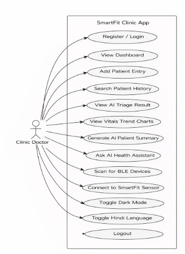</p>
</details>

<details>
<summary><b>Class diagram</b></summary>
<p align="center">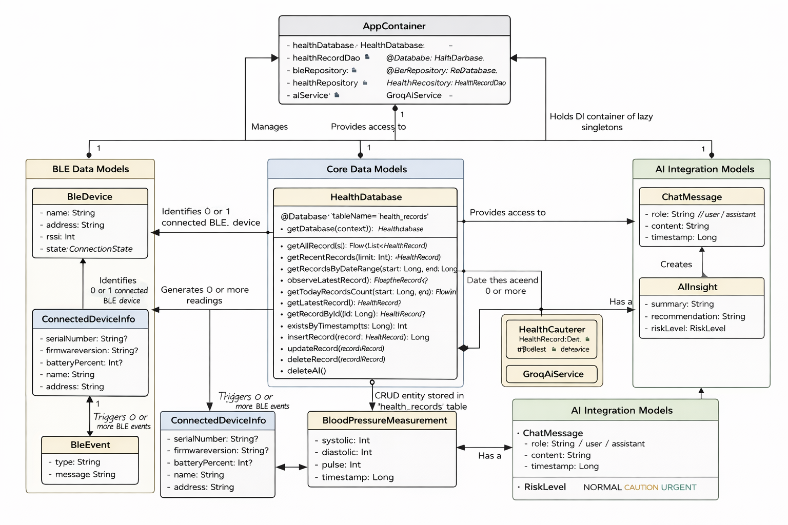</p>
</details>

<details>
<summary><b>Activity diagram</b></summary>
<p align="center">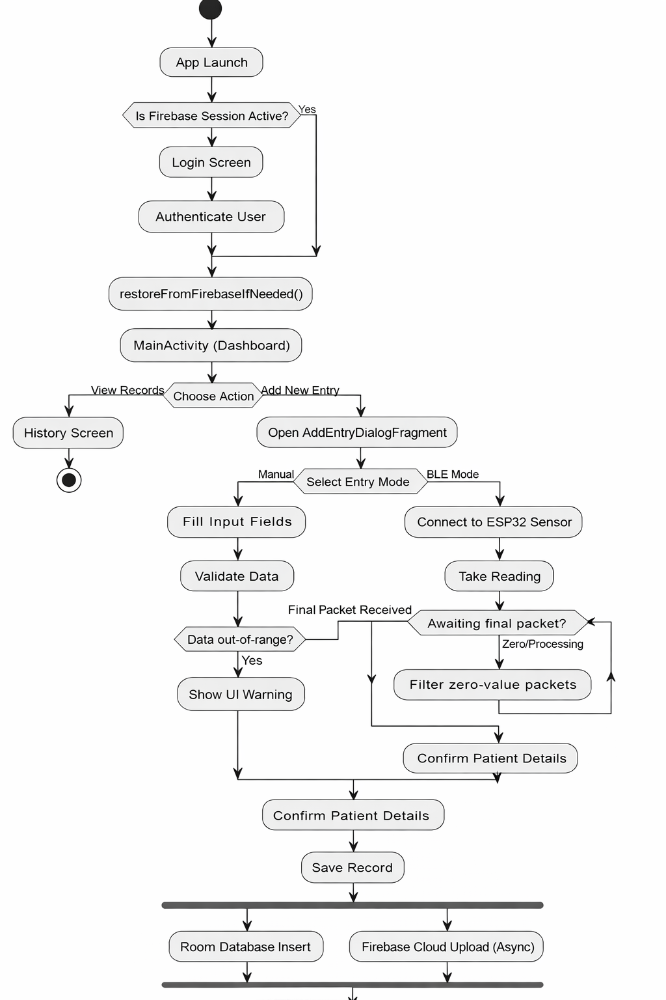</p>
</details>

<details>
<summary><b>Data-flow diagrams</b></summary>
<p align="center">
  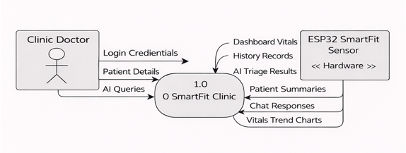<br/><br/>
  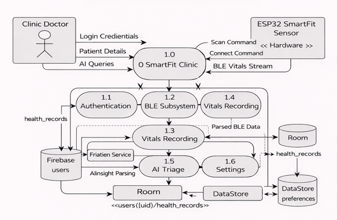
</p>
</details>

---

## Known Limitations

- **API key handling** — `GROQ_API_KEY` must be supplied via `local.properties` / a secrets manager; never commit it as a literal `buildConfigField`.
- **Destructive migration** — Room uses `fallbackToDestructiveMigration()`; schema changes wipe local data until proper migrations are written.
- **KMP stubs** — `BleManager.android.kt` / `BleManager.ios.kt` in `:shared` are placeholders; real BLE logic lives in `:app`'s `BleRepository`. `AuthClient` points at a dummy endpoint, not Firebase.
- **Limited unit tests** — only `HealthRecordTest.kt` is committed; ViewModel / Repository / BLE coroutine tests should be added before production.
- **`suppressAutoSave` thread-safety** — a `@Volatile` flag is fine for the single-writer case but an `AtomicBoolean` would be stricter.
- **`ACCESS_BACKGROUND_LOCATION`** is declared but likely unnecessary for a foreground-only BLE use case and may complicate Play Store review.
- **MTU assumption** — the app requests MTU 512 and assumes acceptance; `onMtuChanged()` logs but does not adapt parsing if a device negotiates lower.
- **Temperature calibration** — the +7.5 °C offset and 36–42 °C clamp are empirically tuned for one sensor batch/environment.
- **AI needs internet** — no on-device fallback model.
- **Out of scope**: EHR / pharmacy integration, languages beyond English & Hindi, automated BP-cuff support.

## Future Enhancements

- Export patient reports (vitals, charts, AI summary) to **PDF / CSV**
- **Multi-doctor** support with per-doctor record isolation and admin roles
- **Appointment scheduling** with reminders
- **iOS companion app** — complete `BleManager.ios.kt` and a SwiftUI front-end over the shared KMP layer
- **Wear OS** companion for passive monitoring
- **ECG** (AD8232) and **blood-pressure cuff** sensors on the ESP32 module
- **Offline AI triage** with an on-device TFLite model as a Groq fallback
- **Clinic-wide analytics** across all patients
- **OTA firmware updates** for the ESP32 over the app's BLE link
- **Multi-device pairing** for multi-bed wards

---

## References

1. Jha, A. K. et al. (2009). *Use of Electronic Health Records in U.S. Hospitals.* NEJM 360(16).
2. Varshney, U. (2007). *Pervasive Healthcare and Wireless Health Monitoring.* Mobile Networks and Applications 12.
3. Bluetooth SIG (2010). *Bluetooth Core Specification 4.0.*
4. Maxim Integrated (2018). *MAX30102 High-Sensitivity Pulse Oximeter and Heart-Rate Sensor* — Datasheet.
5. Castaneda, D. et al. (2018). *A Review on Wearable Technology for Clinical Assessment.* npj Digital Medicine 1, 38.
6. Melexis (2019). *MLX90614 Infrared Thermometer* — Datasheet.
7. Singhal, K. et al. (2023). *Large Language Models Encode Clinical Knowledge.* Nature 620.
8. Groq (2024). *LPU Inference Engine* & *Groq Cloud API Documentation* — <https://console.groq.com/docs/openai>
9. Mukhopadhyay, M. et al. (2021). *VitaLink: A BLE-Enabled Vitals Monitoring Platform for Outpatient Clinics.* IEEE HealthCom.
10. Google — *Firebase Firestore*, *Guide to App Architecture*, *Room Persistence Library* documentation.
11. Espressif Systems (2023). *ESP32 Technical Reference Manual v5.1.*
12. PhilJay — *MPAndroidChart* — <https://github.com/PhilJay/MPAndroidChart>
13. Meta AI (2024). *Llama 3.3.*

---

## License

No license file is currently included — all rights reserved by the repository owner unless stated otherwise.
